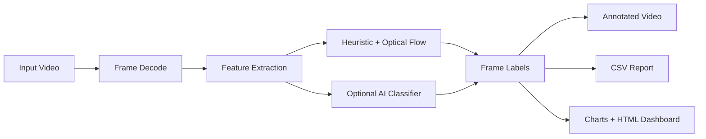

# Pragyan_Khel_Dreambuilder — Video Temporal Error Detector (Frame Drop / Merge)

## Problem
Detect temporal inconsistencies in video streams:
- **Frame Drops** (missing frames)
- **Frame Merges** (blended/combined frames)

Deliverables:
- Working algorithm processing a video input
- Frame-level classification (Normal / Drop / Merge)
- Visual output video + report highlighting inconsistencies
- Brief explanation of approach

---

## What’s inside
- **Heuristic + Optical Flow** detection (strong baseline; no training required)
- **AI-based detector (optional)**: trains a lightweight classifier on **synthetic anomalies** generated from your input video (no external dataset needed)
- **Professional report**: CSV + charts + an **HTML dashboard**

---

## Quick Start

### 1) Setup (recommended: virtualenv)
```bash
python -m venv venv
# Windows: venv\Scripts\activate
# Mac/Linux:
source venv/bin/activate
pip install -r requirements.txt
```

### 2) Add your video
Put an mp4 here:
`sample_video/sample.mp4`

### 3) Run (baseline: optical-flow + heuristics)
```bash
python run_detector.py --input sample_video/sample.mp4
```

### 4) Outputs
- `output/annotated.mp4` — frames highlighted + label overlay
- `output/report.csv` — frame-level labels + metrics
- `reports/dashboard.html` — summary + charts (open in browser)

---

## Optional: AI mode (stronger, hackathon-friendly)
This trains a simple classifier on **synthetic merges/drops** created from your video
and then predicts on the original video.

```bash
python run_detector.py --input sample_video/sample.mp4 --mode ai
```

---

## Repo structure
```
Pragyan_Khel_Dreambuilder/
├── run_detector.py
├── requirements.txt
├── README.md
├── src/
│   ├── detector.py
│   ├── features.py
│   ├── ai_model.py
│   ├── report.py
│   └── viz.py
├── sample_video/
│   └── sample.mp4
├── output/
│   ├── annotated.mp4
│   └── report.csv
└── reports/
    ├── dashboard.html
    ├── summary.json
    └── charts/
        ├── label_timeline.png
        ├── diff_scores.png
        └── flow_scores.png
```

---

## Approach (submission-ready)

### A) Hybrid Optical-Flow + Heuristics (default)
1. **Temporal gap / discontinuity proxy** using:
   - Mean Absolute Difference (MAD) on downscaled grayscale frames
   - **Optical flow magnitude** (Farnebäck) to measure motion consistency
2. **Frame Drop**:
   - flagged when motion/discontinuity spikes exceed robust thresholds (median + MAD)
3. **Frame Merge**:
   - flagged when a frame is “between” neighbors (diff_prev and diff_next both medium-high and similar)
   - plus a blur/ghost cue using **sharpness** (Laplacian variance)

### B) AI mode (optional)
- Extracts features per frame (diffs, flow stats, sharpness)
- Generates synthetic training samples:
  - Drops: removes frames and composes sequences
  - Merges: blends consecutive frames to create ghosting
- Trains a lightweight classifier (Logistic Regression)
- Predicts labels on the real video

---

## Diagram (pipeline)


---

## GitHub submission
Create the repo name exactly as required:
**Pragyan_Khel_Dreambuilder**

Then push:
```bash
git init
git add .
git commit -m "Pragyan Khel submission: temporal error detector"
git branch -M main
git remote add origin https://github.com/YOURUSERNAME/Pragyan_Khel_Dreambuilder.git
git push -u origin main
```

---

## Notes
- If your video is large, AI mode may take longer. Start with default mode first.
- You can tune thresholds via CLI flags (see `--help`).
